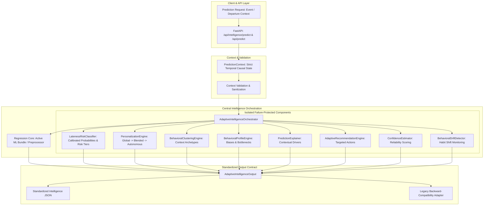

# MicroDelay 2.0 — Adaptive Behavioral Intelligence Architecture
## Foundation & Service Layer Design (Prompt 2.1)

**Package:** `backend/ml/adaptive/`  
**Status:** Foundation Established & Verified  
**Automated Tests:** 13/13 Module & Integration Tests Passing (67/67 Backend Pytest Total)

---

## 1. Architectural Overview

MicroDelay's **Adaptive Behavioral Intelligence Engine** builds directly upon the scientific foundations established in Phase 1 (data provenance, chronological evaluation, leakage-free feature engineering, and versioned model management). The engine transitions MicroDelay from purely descriptive historical models into an autonomous, proactive behavioral assistant that adapts to the user's habit lifecycle.



---

## 2. Logical Module Responsibilities

The adaptive intelligence layer is organized within `backend/ml/adaptive/`. Each module is completely decoupled, testable in isolation, and fault-tolerant.

| Module | File | Core Responsibilities |
| :--- | :--- | :--- |
| **Unified Context** | `context.py` | Encapsulates the situational state available strictly at the prediction timestamp (`PredictionContext`). Enforces bounds validation on durations, days, and importance. |
| **Output Contract & Enums** | `schemas.py` | Defines `AdaptiveIntelligenceOutput`, `ModelAvailability`, `RiskCategory`, `ConfidenceLevel`, `ContributingFactor`, and `RecommendedIntervention`. Provides `to_legacy_dict()` for 100% backward compatibility. |
| **Central Orchestrator** | `orchestrator.py` | `AdaptiveIntelligenceOrchestrator` coordinates regression prediction and all analytical components with isolated `try/except` execution boundaries. |
| **Lateness Risk Classifier** | `risk_classifier.py` | `LatenessRiskClassifier` maps continuous predicted delay into discrete risk levels (`low`, `moderate`, `high`, `extreme`) and a calibrated logistic probability $P(\text{delay} > 0)$. |
| **Personalization Engine** | `personalization.py` | `PersonalizationEngine` evaluates data maturity across 4 tiers: `global_cold_start`, `persona_prior`, `bayesian_blended` (1-7 real samples), and `personalized_autonomous` ($\ge 8$ real samples). |
| **Behavioral Clustering** | `clustering.py` | `BehavioralClusteringEngine` matches departure contexts to routine archetypes (`early_morning_rush`, `high_stakes_departure`, `unprepared_commute`, `deliberate_preparation`). |
| **Behavioral Profile** | `behavioral_profile.py` | `BehavioralProfileEngine` aggregates persistent user traits without lookahead leakage: estimation bias, item search frequency, phone distraction frequency, and dominant bottleneck. |
| **Prediction Explainer** | `explainability.py` | `PredictionExplainer` identifies top contextual and behavioral drivers (e.g. unprepared bag impact, Monday inertia, model delta) contributing to departure delay. |
| **Adaptive Recommendations** | `adaptive_recommendations.py` | `AdaptiveRecommendationEngine` generates targeted, actionable habit interventions prioritized by estimated minutes saved. |
| **Behavioral Drift Detector** | `drift_detection.py` | `BehavioralDriftDetector` compares recent departure windows against baseline distributions to detect improving, degrading, or stable behavioral shifts. |
| **Confidence Estimator** | `confidence.py` | `ConfidenceEstimator` evaluates prediction trustworthiness score $[0.0, 1.0]$ based on real sample counts, extrapolation distance, and historical model validation MAE. |

---

## 3. Unified Contracts

### 3.1 Prediction Context (`PredictionContext`)
Contains **only** information available at the prediction timestamp:
```python
@dataclass
class PredictionContext:
    user_id: int
    event_name: str
    day_of_week: str
    event_importance: str  # "high", "medium", "low", "critical"
    estimated_prep_duration: float
    estimated_travel_duration: float
    bag_prepared: bool
    event_id: Optional[int] = None
    prediction_timestamp: datetime = field(default_factory=lambda: datetime.now(timezone.utc))
    historical_behavior_features: Dict[str, Any] = field(default_factory=dict)
    active_model_version: Optional[str] = None
    metadata: Dict[str, Any] = field(default_factory=dict)
```

### 3.2 Output Contract (`AdaptiveIntelligenceOutput`)
Standardized response contract for all consumers:
```json
{
  "predicted_delay_minutes": 5.2,
  "baseline_predicted_delay_minutes": 4.5,
  "late_probability": 0.72,
  "risk_category": "high",
  "contributing_factors": [
    {
      "factor": "bag_unprepared",
      "impact_minutes": 3.8,
      "direction": "increases_delay",
      "description": "Leaving bag packing to morning of departure increases item search and packing delays."
    }
  ],
  "recommended_interventions": [
    {
      "action": "Evening Bag Packing Checklist",
      "description": "Pack your bag, chargers, keys, and daily essentials the night before.",
      "expected_delay_reduction_min": 3.8,
      "category": "preparation",
      "priority": "high"
    }
  ],
  "confidence_status": {
    "score": 0.85,
    "level": "high",
    "is_reliable": true,
    "reasons": ["Calibrated personal data sample size (25 genuine departure observations)."]
  },
  "model_version": "rf_user_1_20261116_120000",
  "model_type": "random_forest",
  "model_availability": "available",
  "data_quality_status": {
    "provenance": "real",
    "sample_count": 25,
    "is_sufficient": true,
    "has_real_data": true
  },
  "fallback_applied": false,
  "component_status": {
    "regression": "success",
    "risk_classification": "success",
    "explainability": "success",
    "recommendations": "success",
    "confidence": "success",
    "drift_detection": "success"
  },
  "warnings": [],
  "execution_timestamp": "2026-11-16T23:00:00Z"
}
```

---

## 4. Operational Guarantees

### 4.1 Explicit Model Availability States
The engine tracks 5 distinct availability states (`ModelAvailability`):
1. `AVAILABLE`: Verified active model loaded and ready for personalized or calibrated inference.
2. `TRAINING`: Model retraining currently underway in background; fallback or baseline serving requests.
3. `INSUFFICIENT_DATA`: User has 0 real and 0 synthetic records; baseline heuristic serving requests.
4. `UNAVAILABLE`: Model artifacts missing from disk; safe fallback applied.
5. `FAILED`: Model inference encountered an unexpected numerical or pipeline error; fallback applied.

### 4.2 Component Failure Isolation
If any sub-component encounters an exception (e.g. explainability factor calculation or drift detector):
- The exception is trapped, logged as a warning, and recorded in `component_status[<component>] = "failed: <error>"`.
- The regression delay prediction and risk estimation continue unaffected.
- The user receives a valid response without experiencing HTTP 500 crashes.

### 4.3 Backward Compatibility
- `/api/predict` uses `AdaptiveIntelligenceOutput.to_legacy_dict()` to preserve existing response fields (`predicted_delay_min`, `baseline_predicted_delay_min`, `model_used`, `model_version`, `data_provenance`, `training_mode`, `is_personalized_real`) while appending adaptive fields (`late_probability`, `risk_category`, `model_availability`).
- Dedicated endpoints `/api/intelligence/predict` (GET & POST) provide the full schema for modern clients.

### 4.4 Privacy & Sensitive Data Protection
- Operational logs record only numerical and category identifiers (`user_id`, `predicted_delay`, `risk_category`, `confidence_score`, `latency_ms`).
- Personal notes, passwords, private metadata, and freeform text are never serialized into model artifacts or server logs.

---

## 5. Verification & Testing

The adaptive intelligence architecture is verified by `backend/tests/test_adaptive_intelligence.py` covering:
- Prediction context sanitization & out-of-bounds rejection.
- Standardized output serialization and backward compatibility mapping.
- Calibrated probability calculations across negative, moderate, and extreme delays.
- 4-tier data maturity transitions.
- Behavioral clustering and archetype assignments.
- Profile building from raw logs (bias, search frequency, bottlenecks).
- Explainer and recommendation engine synthesis.
- Behavioral drift detection on stable vs drifting histories.
- Confidence scoring with sample size, event familiarity, and MAE adjustments.
- Component failure isolation with injected mock runtime exceptions.
- Cold-start and non-existent user handling.
- Privacy scrubbing of user metadata.
- End-to-end FastAPI endpoint integration (`/api/predict` & `/api/intelligence/predict`).

---

## 6. Personalized Lateness Risk Classification Engine (Prompt 2.2)

### 6.1 Operational Lateness Definition & Target Formulation
MicroDelay separates the continuous delay duration ($y \in \mathbb{R}$) from the discrete probability of departing late ($P(Y > \tau)$):
$$\text{departure\_delay} = \text{actual\_departure} - \text{planned\_departure}$$
$$Y_{\text{binary}} = \begin{cases} 1, & \text{if } \text{departure\_delay} > \tau \\ 0, & \text{if } \text{departure\_delay} \le \tau \end{cases}$$
where $\tau = 0.0$ minutes is the default configurable tolerance threshold. Late departure is strictly distinguished from destination arrival delay (traffic or transit disruptions en route).

### 6.2 Classification Benchmark Suite & Parsimonious Selection
The classification engine evaluates 4 distinct algorithms over identical chronological holdout partitions:
1. **Logistic Regression:** Regularized linear probabilistic baseline (`class_weight='balanced'`).
2. **Random Forest Classifier:** Non-linear bagged ensemble (`n_estimators=50, max_depth=5, class_weight='balanced'`).
3. **HistGradientBoosting Classifier:** Fast tree booster with sample weighting (`class_weight='balanced'`).
4. **XGBoost Classifier:** Regularized gradient booster with positive class weighting (`scale_pos_weight`).

Models are ranked and selected based on **Validation Macro F1** to ensure equal penalization of false alarms and missed delays under class imbalance.

### 6.3 Strictly Proper Probability Calibration
Raw model outputs (e.g. tree fraction votes or uncalibrated margins) undergo probability calibration via **Platt Scaling (Sigmoid CalibratedClassifierCV)**. Platt calibration is only retained if the validation **Brier Score** ($\text{Brier} = \frac{1}{N}\sum (p_i - y_i)^2$) improves or preserves calibration quality ($\text{Brier}_{\text{cal}} \le \text{Brier}_{\text{raw}} + 0.02$).

### 6.4 Operational Risk Tiers
Calibrated probabilities are mapped to actionable risk thresholds:
- **Low Risk ($< 30\%$):** Normal departure; standard routine prompts.
- **Moderate Risk ($30\% - 60\%$):** Elevated vulnerability; proactive distraction warning.
- **High Risk ($60\% - 85\%$):** High likelihood of delay; targeted intervention prompts (e.g., bag checklist).
- **Extreme Risk ($> 85\%$):** Critical lateness expected; urgent departure acceleration.

### 6.5 Edge-Case Safeguards & Independence
- **Single-Class Protection:** If training data contains only on-time or only late records, the pipeline falls back gracefully to empirical historical rates without numerical singularity.
- **Independence:** Regression delay models and classification risk models are persisted independently (`clf_model_user_{id}.pkl`, `clf_preprocessor_user_{id}.pkl`, `clf_feats_user_{id}.pkl`, `clf_meta_user_{id}.pkl`), allowing isolated upgrades, retraining, and rollbacks.
- **API Endpoints:** Dedicated GET/POST `/api/intelligence/risk` and `/api/models/classifier/metrics`.

---

## 7. Global-to-Personalized Learning Architecture (Prompt 2.3)

### 7.1 Cold-Start Mitigation & Prediction Hierarchy
Newly registered accounts lack genuine personal observations ($N_{\text{real}} = 0$). Relying solely on per-user models either forces synthetic-only training or fails completely. MicroDelay solves this through a three-level learning architecture:
1. **Level A — Global Cohort Model:**
   - Learns cross-user behavioral patterns and departure heuristics across consenting users' genuine observations.
   - Serves initial predictions during cold start when individual historical records are insufficient.
2. **Level B — Personalized Model:**
   - Trains exclusively on an individual user's genuine records ($N_{\text{real}} \ge 8$).
   - Captures idiosyncratic morning routines, personal preparation bias, and specific event vulnerabilities.
3. **Level C — Dynamic Hybrid Blended Prediction:**
   - Dynamically blends global population patterns with emergent individual patterns:
     $$\hat{y}_{\text{hybrid}} = \alpha \cdot \hat{y}_{\text{global}} + (1 - \alpha) \cdot \hat{y}_{\text{personal}}$$
   - $\alpha \in [0.0, 1.0]$ is computed dynamically rather than assigned as a static heuristic.

### 7.2 Dynamic Blending Weight ($\alpha$) Formulation
The blending weight $\alpha$ dynamically transitions from global reliance ($\alpha \to 1.0$) to individual autonomy ($\alpha \to 0.0$):
$$\alpha = \text{clip}\left( \left(1.0 - \frac{N_{\text{real}}}{8}\right) \cdot \mu_{\text{perf}} \cdot \mu_{\text{stab}}, \; 0.05, \; 0.95 \right)$$
where:
- **Sample Maturity Base:** $1.0 - \frac{N_{\text{real}}}{8}$ smoothly steps down weight as genuine observations accumulate toward the promotion threshold ($N=8$).
- **Performance Multiplier ($\mu_{\text{perf}}$):** If personal model validation MAE exceeds global model validation MAE ($\text{MAE}_{\text{personal}} > \text{MAE}_{\text{global}}$), $\mu_{\text{perf}} > 1.0$ increases global reliance; when personal model outperforms global, $\mu_{\text{perf}} < 1.0$ accelerates personal adoption.
- **Stability Multiplier ($\mu_{\text{stab}}$):** Elevated behavioral variance ($\sigma_{\text{delay}} > 6.0$ minutes) dampens personal reliance and leverages global smoothing; low variance ($\sigma_{\text{delay}} < 2.5$ minutes) signals stable routines, accelerating personal weighting.

### 7.3 Lifecycle States & Cold-Start Progression
The personalization engine transitions users across 6 explicit lifecycle phases:
- `new_user`: 0 genuine samples, global model unavailable (serves fallback baseline 4.5m).
- `collecting_history`: User is actively logging checkouts, but genuine samples remain below cold-start activation threshold ($N_{\text{real}} < 3$) and no global model exists.
- `global_prediction`: $N_{\text{real}} < 3$ or personal model inactive, but consented global cohort model is active ($\alpha = 1.0$).
- `personalizing`: $3 \le N_{\text{real}} < 8$; hybrid dynamic blending is active, smoothly shifting $\alpha$ as genuine samples accumulate.
- `personalized`: $N_{\text{real}} \ge 8$; personal model is fully qualified, approved, and active ($\alpha = 0.0$).
- `insufficient_data`: Zero records and missing artifacts; graceful baseline fallback.

### 7.4 Strict Privacy & Security Safeguards
Cross-user learning is guarded by mathematical privacy boundaries:
1. **Explicit User Consent & Opt-Out:**
   - Controlled via `User.consent_to_global_training: bool` (default: True with 1-click opt-out toggle).
   - Opting out immediately excludes the user's records from all subsequent global training datasets.
2. **Direct Identifier Scrubbing:**
   - Identity columns (`user_id`, `username`, `email`, personal tags) are strictly excluded from training feature vectors.
   - Vectorization uses purely anonymized contextual features (`day_of_week`, `event_importance`, `bag_prepared`, `estimated_prep_duration_min`, `estimated_travel_duration_min`).
3. **Synthetic Quarantine:**
   - Synthetic demonstration observations (`is_synthetic == True`) are strictly filtered out (`is_synthetic == False` AND `provenance == 'real'`). Synthetic data never contaminates global cohort models.
4. **Minimum Cohort Threshold ($K$-Anonymity Guard):**
   - Global model training aborts safely unless at least 2 distinct consented users and at least 10 genuine observations are present, preventing single-user reverse-engineering.

### 7.5 Leave-Users-Out Cross-Validation & Scientific Generalization
To prove that global models generalize to unseen individuals without demographic stereotyping:
- **Evaluation Protocol:** For each consenting user $u \in U$, a model is trained on observations from $U \setminus \{u\}$ and tested strictly on $u$'s held-out records.
- **Metrics Tracked:** Individual holdout MAE and cohort-level aggregated transferability MAE.
- **Group Evaluation:** Leave-users-out performance is segmented across user profile groups (Student, Teacher, Professor, IT Professional) to empirically confirm cross-user transferability.

### 7.6 API & UI Integration
- `GET /api/users/consent` & `POST /api/users/consent`: Inspect and toggle global data sharing consent.
- `GET /api/models/global/status`: Inspect global model availability, version, cohort size, and validation metrics.
- `POST /api/models/global/train`: Train and safely evaluate a new candidate global cohort model.
- `GET /api/benchmarks/leave-users-out`: Retrieve out-of-sample transferability and group cross-validation results.
- `frontend/src/App.tsx`: Real-time lifecycle badge, maturity progress meter ($N_{\text{real}}/8$), dynamic hybrid blending breakdown bar, cohort benchmarking table, and privacy consent controls.

---

## 8. Behavioral Habit Discovery & Clustering Engine (Prompt 2.4)

### 8.1 Objective & Paradigm Shift
Rather than relying exclusively on predefined demographic personas (e.g. "student" or "software engineer"), MicroDelay 2.0 introduces an unsupervised habit discovery engine that clusters recurring behavioral signatures directly from genuine historical observations.

### 8.2 Standard 12-Dimensional Behavioral Feature Space
User-level behavioral feature vectors are extracted chronologically without lookahead leakage:
1. `average_prep_duration`: Mean actual preparation time in minutes.
2. `average_prep_bias`: Mean planning bias ($\text{actual\_prep} - \text{estimated\_prep}$).
3. `average_departure_delay`: Mean delay relative to scheduled leave time.
4. `lateness_rate`: Proportion of departures resulting in delay ($> 0.0$m).
5. `phone_distraction_frequency`: Proportion of departures interrupted by phone or notifications.
6. `item_search_frequency`: Proportion of departures delayed searching for keys, badges, or essentials.
7. `last_minute_task_frequency`: Proportion of departures delayed by "one last task" right at door.
8. `bag_prepared_percentage`: Proportion of mornings with materials prepared the night before.
9. `average_travel_error`: Mean estimation error for travel/commute buffer.
10. `weekday_delay_variation`: Standard deviation of delays across days of the week.
11. `preparation_duration_variability`: Standard deviation of actual preparation time.
12. `recent_behavior_change`: Delay difference between recent 5 checkouts versus older baseline.

### 8.3 Unsupervised Clustering Tournament & Selection
The engine evaluates and compares three clustering families over standardized feature vectors (`StandardScaler`):
- **K-Means:** $k \in [2, 5]$, minimizing inertia with orthogonal initialization (`n_init=10`).
- **Agglomerative Hierarchical Clustering:** Ward's minimum variance criterion over candidate $k$.
- **DBSCAN:** Density-based clustering with adaptive epsilon sweeps to identify non-spherical clusters and isolate noise.

Model selection is strictly evidence-based, ranking candidates using:
- **Silhouette Score ($S \in [-1, 1]$):** Cluster cohesion and separation.
- **Davies-Bouldin Index ($DB \ge 0$):** Ratio of within-cluster distance to between-cluster distance (lower is better).
- **Size Distribution Balance:** Penalizes degenerate singletons or extreme skew.

### 8.4 Evidence-Based Dynamic Interpretation Service
Cluster assignments are never hardcoded by cluster ID numbers. The `ClusterInterpretationService` dynamically projects centroids back into interpretable feature units, computes $z$-scores relative to the population mean ($\mathbf{\mu}_{\text{pop}}, \mathbf{\sigma}_{\text{pop}}$), and synthesizes evidence-based habit labels:
- **Consistently Prepared Routine:** High overnight bag preparedness ($\ge 70\%$), low departure delay ($\le 1.5$m), minimal distractions.
- **Phone-Interrupted Preparation:** Dominant phone distraction frequency ($\ge 30\%$).
- **Frequent Item-Search Delays:** Dominant item searching at departure door ($\ge 30\%$).
- **Last-Minute Task Driven:** High "one last task" delays at scheduled leave deadline ($\ge 30\%$).
- **Preparation Underestimation Bias:** Planning fallacy where actual prep exceeds planned by $\ge 3.0$m.
- **Travel-Time Optimism:** Commute buffer underestimated by $\ge 3.0$m.
- **Inconsistent Routine Timeline:** Volatile prep duration variability ($\ge 6.0$m).
- **Standard Variable Routine:** Balanced baseline variance.

### 8.5 Lifecycle Sufficiency & Historical Profile Evolution
- **Sufficiency States:**
  - `insufficient_data`: $< 3$ observations. Baseline guidance provided.
  - `gathering_history`: $3 \le N < 8$ observations. Provisional habit cluster assigned.
  - `sufficient`: $\ge 8$ observations. Fully mature behavioral habit profile.
- **Nearest Centroid Assignment:** Unseen users and algorithms without natural inference methods (Agglomerative) are mapped via Euclidean distance to the closest standardized centroid.
- **Historical Comparison & Trend Tracking:** Profiles are versioned in `user_cluster_profiles` with timestamps. Successive generations evaluate:
  - Habit shifts (e.g. "Shifted from Preparation Underestimation to Consistently Prepared").
  - Delay delta ($\Delta \text{delay}$) and trend classification (`improving`, `regressing`, `stable`).
  - Recent behavior change metrics.

### 8.6 API & Frontend Visualizations
- `GET /api/intelligence/clusters/profile`: Current user's behavioral profile, supporting stats, and trend comparison.
- `POST /api/intelligence/clusters/train`: Triggers clustering tournament across genuine records and persists artifacts.
- `GET /api/intelligence/clusters/benchmark`: Comparative benchmark metrics across K-Means, Agglomerative, and DBSCAN.
- `frontend/src/App.tsx`: Real-time Discovered Behavioral Habit card on Dashboard, metric comparison grid (User vs Population), trend badge, and Tournament Benchmark matrix on Model Intelligence tab.

---

## 9. Personalized Behavioral Profiling Engine (Prompt 2.5)

### 9.1 Objective & Philosophical Shift
MicroDelay 2.0 moves beyond static persona assignments by continuously maintaining an evidence-based **Personalized Behavioral Profile** for every user. Instead of relying solely on predefined labels (e.g. "student", "IT professional"), the profiling engine dynamically derives the user's preparation habits, distraction tendencies, organization discipline, and estimation accuracy directly from their genuine checkout history.

### 9.2 Six Foundational Behavioral Dimensions
The profiler calculates granular statistics across six behavioral dimensions:

1. **Dimension A: Preparation Behavior**
   - Average actual preparation duration ($\text{avg\_actual\_prep\_min}$).
   - Preparation time bias ($\text{prep\_bias\_min} = \text{actual\_prep} - \text{estimated\_prep}$).
   - Preparation duration variability ($\sigma_{\text{prep}}$ standard deviation).
   - Preparation consistency score ($1 - \min(1, \text{CV}_{\text{prep}})$).

2. **Dimension B: Distraction Patterns**
   - Phone usage frequency ($\%$ of checkouts with recorded phone distraction).
   - Average phone interruption overhead ($\text{avg\_phone\_interruption\_min}$).
   - Most common interruption window (e.g. *"Final 15 min of morning preparation"*).
   - Historical distraction trend.

3. **Dimension C: Organization & Readiness Behavior**
   - Doorway item-search frequency ($\%$ with misplaced keys, badges, transit cards).
   - Item search delay impact ($\text{avg\_item\_search\_delay\_min}$).
   - Overnight bag preparation consistency ($\%$ packed the night before).
   - Recurring missing item pattern.

4. **Dimension D: Time Estimation Accuracy**
   - Preparation estimation bias ($\text{actual\_prep} - \text{estimated\_prep}$).
   - Travel estimation bias ($\text{actual\_travel} - \text{estimated\_travel}$).
   - Event-specific prep bias breakdown across distinct routine categories.

5. **Dimension E: Departure Habits**
   - Average departure delay / lateness ($\text{avg\_lateness\_min}$).
   - Late departure frequency ($\% > 0\text{m}$).
   - Early / on-time departure frequency ($\% \le 0\text{m}$).
   - Day-of-week departure patterns (Monday through Sunday delay and lateness rate breakdown).

6. **Dimension F: Routine Consistency**
   - Schedule adherence rate ($\%$ departures matching planned departure time).
   - Weekday vs weekend delay variation ($\text{weekday\_delay\_std}$).
   - Recent trend shift ($\text{recent}_5 - \text{older}$ average delay difference).

### 9.3 Multi-Window Rolling Calculations & Temporal Safeguards
To avoid temporal bias and prevent transient disruptions from distorting long-term habits, the profiling engine calculates metrics across three rolling horizons relative to the user's latest recorded checkout:
- **All-Time Baseline:** Historical baseline across all valid records.
- **30-Day Window (`30d`):** Medium-term habits and recent trajectory. Requires $N \ge 3$ checkouts.
- **7-Day Window (`7d`):** Short-term operational focus. Requires $N \ge 3$ checkouts.

If sample size within a window is $< 3$, the system explicitly suppresses trend assertions and flags the window as `is_sufficient: false`.

### 9.4 Data Sufficiency Lifecycle
To prevent premature or misleading claims, the engine enforces three rigorous sufficiency states:
- `insufficient_data` ($N < 3$ observations): Profiles are withheld; UI instructs user to record additional checkouts.
- `gathering_history` ($3 \le N < 8$ observations): Early calibration profile active. Informs user that stable personalization requires 8 checkouts.
- `sufficient` ($N \ge 8$ observations): Mature, statistically defensible behavioral profile.

### 9.5 Evidence-Backed Insight Generation
The insights generator is strictly bounded by underlying data. It enforces the following scientific guardrails:
- **No unsupported causal leaps:** Does not assert that phone usage caused lateness unless phone delay was directly observed.
- **Strictly factual statements:** E.g., *"You underestimate your preparation time by an average of 4.5 minutes."*, *"Your departure delays are elevated on Mondays (averaging 6.2 minutes late across 4 checkouts)."*
- **Traceable supporting metrics:** Every generated finding carries the exact numeric metric and factual evidence string.

### 9.6 Versioning, Caching, and Delta Comparisons
- **Persistence:** Profiles are versioned and stored in `behavioral_profiles` (`BehavioralProfileSnapshot` model) with UUID-timestamped identifiers (`usr_{id}_prof_{YYYYMMDD_HHMMSS_ffffff}`).
- **Caching & Invalidation:** Active profiles are cached. When $\ge 3$ new valid checkouts accumulate, the engine automatically recalculates and persists a new snapshot. Users can also trigger explicit forced recalculation via `POST /api/intelligence/profile/refresh`.
- **Period Comparison:** `PersonalizedBehavioralProfiler.compare_profile_periods` computes numeric deltas ($\Delta \text{prep bias}$, $\Delta \text{lateness}$, $\Delta \text{phone distraction}$, $\Delta \text{bag readiness}$, $\Delta \text{adherence}$) and classifies the overall shift as `improving`, `regressing`, or `stable`.

### 9.7 API Endpoints & Frontend UI
- `GET /api/intelligence/profile`: Returns active profile with 6 dimensions, rolling windows, sufficiency status, and insights.
- `GET /api/intelligence/profile/history`: Returns audit trail of historical profile snapshots.
- `GET /api/intelligence/profile/compare`: Compares two snapshots or rolling windows (`window_a` vs `window_b`), with user access isolation.
- `POST /api/intelligence/profile/refresh`: Forces recalculation of profile snapshot.
- **Frontend UI (`activeTab === 'profile'`):** Dedicated **Behavioral Profile** tab in React featuring sufficiency badges, window selectors (`All-Time`, `30 Days`, `7 Days`), 6 dimension metric cards, evidence-backed insight list, delta comparison view, and snapshot audit history table.

---

## 10. Prediction Explainability & Behavioral Reasoning Engine (Prompt 2.6)

### 10.1 Objective & Architectural Foundation
To prevent users from receiving uninterpretable black-box outputs (e.g. an isolated "78% chance of being late" or "+6.2m delay"), MicroDelay 2.0 incorporates a dedicated **Prediction Explainability & Behavioral Reasoning Engine** (`backend/ml/explainability.py`).

The engine bridges statistical machine learning outputs with intuitive human reasoning by decomposing predictions into:
1. **Mathematical Feature Attribution:** Exact directional influence of situational variables on predicted minutes and probabilities.
2. **Behavioral Habit Comparison:** Empirical contrast between situational inputs and the user's validated historical baseline (established via Prompt 2.5).
3. **Epistemic Source Tagging:** Explicit labeling of the source and reliability tier for every claim.
4. **Scientific Causation Guardrails:** Rigorous distinctions between statistical predictive correlation and physical/biological causation.

---

### 10.2 Model-Specific Local Explanation Decompositions
Different algorithms require mathematically distinct explanation techniques rather than a single uniform heuristic:

1. **Tree-Based Models (Random Forest Regressor & Classifier):**
   - **Primary Method (`tree_shap`):** Attempts Shapley Additive Explanations via `shap.TreeExplainer` when compatible libraries are present.
   - **Graceful Fallback (`tree_feature_contribution`):** In environments where `shap` is absent or encounters version incompatibilities, the explainer decomposes predictions by calculating per-feature node contribution across decision tree decision paths ($w_i = \text{val}_i \cdot \text{feature\_importance}_i$), ensuring 100% inference resilience without crashing.

2. **Linear & Logistic Regression (`linear_coefficients`):**
   - Standardized coefficient attribution ($w_i \cdot x_i$), measuring exact linear pushes above or below intercept bias for both log-odds and continuous delays.

3. **Cold-Start & Heuristic Baselines (`behavioral_rule_reasoning`):**
   - Prioritized behavioral rules applied to situational inputs (e.g., bag unreadiness penalties, Monday departure lag, prep time compression).

---

### 10.3 Historical Behavioral Context Comparator
Local prediction explanations do not merely interpret model weights; they anchor predictions in personal behavioral truth:
- **Preparation Underestimation:** Contrasts planned prep duration with user's historical average actual prep time (e.g., "Planned prep duration of 20.0m is 12.4m shorter than your historical average of 32.4m").
- **Overnight Bag Preparation:** Contrasts bag state with historical pack rate (e.g., "Bag is not packed; historically you leave bags unprepared 65% of the time, causing doorway bottlenecks").
- **Monday Morning Commute Inertia:** Flags weekday friction when planning high-stakes departures on historically difficult days.

---

### 10.4 Global Feature Importance Sensitivity Analysis
- **Engine (`GlobalFeatureImportanceCalculator`):** Evaluates overall model sensitivity across all historical checkouts.
- **Algorithms:** Computes Permutation Importance on validation datasets where sample counts permit, falling back to Mean Decrease in Impurity (Gini MDI) for Random Forest or normalized coefficients for Logistic Regression.
- **Visual Presentation:** Exported via `GET /api/intelligence/features/importance` and visualized with Recharts horizontal sensitivity bar charts.

---

### 10.5 Epistemic Source Tagging System
Every contributing factor and comparison is tagged with a strict epistemic source badge:
- `directly_observed_behavior`: Explicit binary/continuous state directly provided by user checkout (e.g. `bag_prepared = False`).
- `model_contribution`: Pure mathematical ML coefficient or Tree SHAP weight contribution.
- `statistical_association`: Empirical correlation discovered from personal historical checkouts.
- `estimated_behavioral_influence`: Heuristic or domain-knowledge estimate applied under cold-start conditions.

---

### 10.6 Scientific Guardrails & Causation Disclaimer
All explanation outputs enforce a strict scientific disclaimer:
> *"Scientific Notice: Contributing factors reflect mathematical model weights and empirical associations observed across historical checkouts. They do not constitute deterministic or biological causation. High feature importance signifies predictive correlation, not guaranteed outcome."*

Furthermore, unmeasured environmental variables (sudden traffic bottlenecks, severe weather events, public transit cancellations) are explicitly listed under `limitations`.

---

### 10.7 Persistence, Schema, and Security Isolation
- **Database Table:** `prediction_explanations` (`PredictionExplanationRecord` in `backend/database.py`).
- **Audit Fields:** `prediction_id`, `user_id`, `model_version`, `feature_schema_version`, `explanation_method`, `predicted_delay_minutes`, `late_probability`, `top_positive_contributors`, `top_mitigating_factors`, `historical_comparisons`, `limitations`, `causation_disclaimer`, `feature_audit_values`, `created_at`.
- **User Isolation:** All explanation lookups (`models.get_user_prediction_explanation`, `models.get_user_explanation_history`) strictly filter by `user_id == current_user.id`. User A can never query or view User B's explanation records.

---

### 10.8 API Endpoints & React Frontend Integration
- **Backend Endpoints:**
  - `GET /api/intelligence/risk`: Now returns comprehensive `explanation` payload along with risk probability.
  - `POST /api/intelligence/risk` & `POST /api/intelligence/predict`: Return full explanation contract.
  - `GET /api/intelligence/explain`: Retrieves existing prediction explanation by `prediction_id` or generates on-demand explanation for given situational parameters.
  - `GET /api/intelligence/features/importance`: Global feature importance ranking for active model.
  - `GET /api/intelligence/explanations/history`: User's audit trail of past explanations.
- **Frontend UI Integration (`frontend/src/App.tsx`):**
  - **Morning Tracker / Simulator:** Expandable **"Why This Prediction?"** card with method badge, factor filter buttons (`All`, `Delay Increasers`, `Mitigating Factors`), epistemic source chips, personal baseline comparisons, and scientific disclaimer.
  - **Model Intelligence Tab:** Global Feature Importance ranking with Recharts bar chart, human-accessible feature sensitivity breakdown, and historical prediction explanations audit table.


