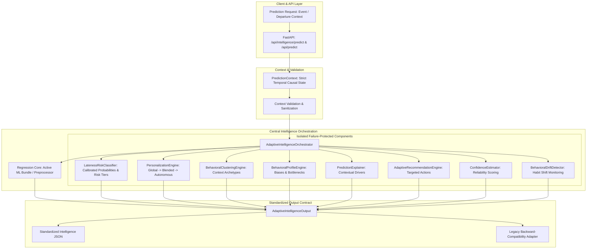

# MicroDelay 2.0 — Adaptive Behavioral Intelligence Architecture
## Foundation & Service Layer Design (Prompt 2.1)

**Package:** `backend/ml/adaptive/`  
**Status:** Foundation Established & Verified  
**Automated Tests:** 13/13 Module & Integration Tests Passing (67/67 Backend Pytest Total)

---

## 1. Architectural Overview

MicroDelay's **Adaptive Behavioral Intelligence Engine** builds directly upon the scientific foundations established in Phase 1 (data provenance, chronological evaluation, leakage-free feature engineering, and versioned model management). The engine transitions MicroDelay from purely descriptive historical models into an autonomous, proactive behavioral assistant that adapts to the user's habit lifecycle.



---

## 2. Logical Module Responsibilities

The adaptive intelligence layer is organized within `backend/ml/adaptive/`. Each module is completely decoupled, testable in isolation, and fault-tolerant.

| Module | File | Core Responsibilities |
| :--- | :--- | :--- |
| **Unified Context** | `context.py` | Encapsulates the situational state available strictly at the prediction timestamp (`PredictionContext`). Enforces bounds validation on durations, days, and importance. |
| **Output Contract & Enums** | `schemas.py` | Defines `AdaptiveIntelligenceOutput`, `ModelAvailability`, `RiskCategory`, `ConfidenceLevel`, `ContributingFactor`, and `RecommendedIntervention`. Provides `to_legacy_dict()` for 100% backward compatibility. |
| **Central Orchestrator** | `orchestrator.py` | `AdaptiveIntelligenceOrchestrator` coordinates regression prediction and all analytical components with isolated `try/except` execution boundaries. |
| **Lateness Risk Classifier** | `risk_classifier.py` | `LatenessRiskClassifier` maps continuous predicted delay into discrete risk levels (`low`, `moderate`, `high`, `extreme`) and a calibrated logistic probability $P(\text{delay} > 0)$. |
| **Personalization Engine** | `personalization.py` | `PersonalizationEngine` evaluates data maturity across 4 tiers: `global_cold_start`, `persona_prior`, `bayesian_blended` (1-7 real samples), and `personalized_autonomous` ($\ge 8$ real samples). |
| **Behavioral Clustering** | `clustering.py` | `BehavioralClusteringEngine` matches departure contexts to routine archetypes (`early_morning_rush`, `high_stakes_departure`, `unprepared_commute`, `deliberate_preparation`). |
| **Behavioral Profile** | `behavioral_profile.py` | `BehavioralProfileEngine` aggregates persistent user traits without lookahead leakage: estimation bias, item search frequency, phone distraction frequency, and dominant bottleneck. |
| **Prediction Explainer** | `explainability.py` | `PredictionExplainer` identifies top contextual and behavioral drivers (e.g. unprepared bag impact, Monday inertia, model delta) contributing to departure delay. |
| **Adaptive Recommendations** | `adaptive_recommendations.py` | `AdaptiveRecommendationEngine` generates targeted, actionable habit interventions prioritized by estimated minutes saved. |
| **Behavioral Drift Detector** | `drift_detection.py` | `BehavioralDriftDetector` compares recent departure windows against baseline distributions to detect improving, degrading, or stable behavioral shifts. |
| **Confidence Estimator** | `confidence.py` | `ConfidenceEstimator` evaluates prediction trustworthiness score $[0.0, 1.0]$ based on real sample counts, extrapolation distance, and historical model validation MAE. |

---

## 3. Unified Contracts

### 3.1 Prediction Context (`PredictionContext`)
Contains **only** information available at the prediction timestamp:
```python
@dataclass
class PredictionContext:
    user_id: int
    event_name: str
    day_of_week: str
    event_importance: str  # "high", "medium", "low", "critical"
    estimated_prep_duration: float
    estimated_travel_duration: float
    bag_prepared: bool
    event_id: Optional[int] = None
    prediction_timestamp: datetime = field(default_factory=lambda: datetime.now(timezone.utc))
    historical_behavior_features: Dict[str, Any] = field(default_factory=dict)
    active_model_version: Optional[str] = None
    metadata: Dict[str, Any] = field(default_factory=dict)
```

### 3.2 Output Contract (`AdaptiveIntelligenceOutput`)
Standardized response contract for all consumers:
```json
{
  "predicted_delay_minutes": 5.2,
  "baseline_predicted_delay_minutes": 4.5,
  "late_probability": 0.72,
  "risk_category": "high",
  "contributing_factors": [
    {
      "factor": "bag_unprepared",
      "impact_minutes": 3.8,
      "direction": "increases_delay",
      "description": "Leaving bag packing to morning of departure increases item search and packing delays."
    }
  ],
  "recommended_interventions": [
    {
      "action": "Evening Bag Packing Checklist",
      "description": "Pack your bag, chargers, keys, and daily essentials the night before.",
      "expected_delay_reduction_min": 3.8,
      "category": "preparation",
      "priority": "high"
    }
  ],
  "confidence_status": {
    "score": 0.85,
    "level": "high",
    "is_reliable": true,
    "reasons": ["Calibrated personal data sample size (25 genuine departure observations)."]
  },
  "model_version": "rf_user_1_20261116_120000",
  "model_type": "random_forest",
  "model_availability": "available",
  "data_quality_status": {
    "provenance": "real",
    "sample_count": 25,
    "is_sufficient": true,
    "has_real_data": true
  },
  "fallback_applied": false,
  "component_status": {
    "regression": "success",
    "risk_classification": "success",
    "explainability": "success",
    "recommendations": "success",
    "confidence": "success",
    "drift_detection": "success"
  },
  "warnings": [],
  "execution_timestamp": "2026-11-16T23:00:00Z"
}
```

---

## 4. Operational Guarantees

### 4.1 Explicit Model Availability States
The engine tracks 5 distinct availability states (`ModelAvailability`):
1. `AVAILABLE`: Verified active model loaded and ready for personalized or calibrated inference.
2. `TRAINING`: Model retraining currently underway in background; fallback or baseline serving requests.
3. `INSUFFICIENT_DATA`: User has 0 real and 0 synthetic records; baseline heuristic serving requests.
4. `UNAVAILABLE`: Model artifacts missing from disk; safe fallback applied.
5. `FAILED`: Model inference encountered an unexpected numerical or pipeline error; fallback applied.

### 4.2 Component Failure Isolation
If any sub-component encounters an exception (e.g. explainability factor calculation or drift detector):
- The exception is trapped, logged as a warning, and recorded in `component_status[<component>] = "failed: <error>"`.
- The regression delay prediction and risk estimation continue unaffected.
- The user receives a valid response without experiencing HTTP 500 crashes.

### 4.3 Backward Compatibility
- `/api/predict` uses `AdaptiveIntelligenceOutput.to_legacy_dict()` to preserve existing response fields (`predicted_delay_min`, `baseline_predicted_delay_min`, `model_used`, `model_version`, `data_provenance`, `training_mode`, `is_personalized_real`) while appending adaptive fields (`late_probability`, `risk_category`, `model_availability`).
- Dedicated endpoints `/api/intelligence/predict` (GET & POST) provide the full schema for modern clients.

### 4.4 Privacy & Sensitive Data Protection
- Operational logs record only numerical and category identifiers (`user_id`, `predicted_delay`, `risk_category`, `confidence_score`, `latency_ms`).
- Personal notes, passwords, private metadata, and freeform text are never serialized into model artifacts or server logs.

---

## 5. Verification & Testing

The adaptive intelligence architecture is verified by `backend/tests/test_adaptive_intelligence.py` covering:
- Prediction context sanitization & out-of-bounds rejection.
- Standardized output serialization and backward compatibility mapping.
- Calibrated probability calculations across negative, moderate, and extreme delays.
- 4-tier data maturity transitions.
- Behavioral clustering and archetype assignments.
- Profile building from raw logs (bias, search frequency, bottlenecks).
- Explainer and recommendation engine synthesis.
- Behavioral drift detection on stable vs drifting histories.
- Confidence scoring with sample size, event familiarity, and MAE adjustments.
- Component failure isolation with injected mock runtime exceptions.
- Cold-start and non-existent user handling.
- Privacy scrubbing of user metadata.
- End-to-end FastAPI endpoint integration (`/api/predict` & `/api/intelligence/predict`).
