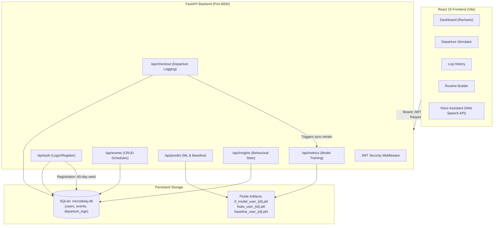
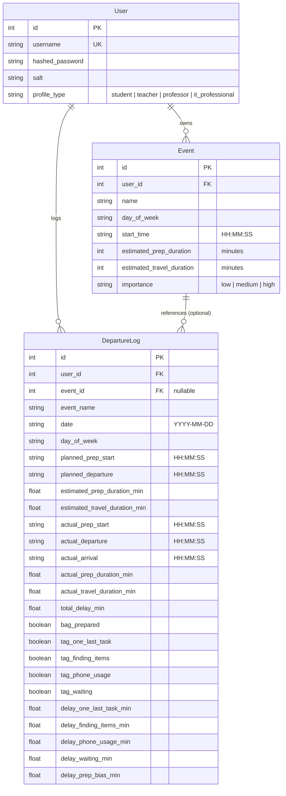
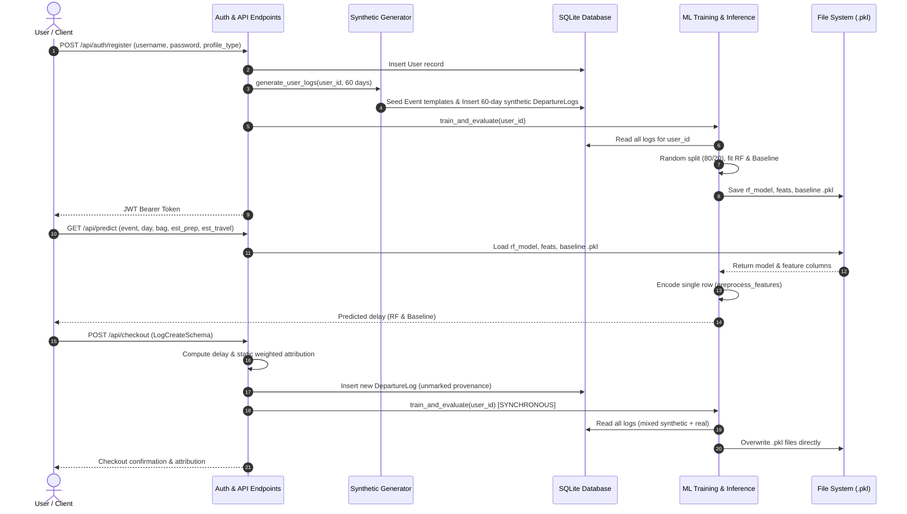
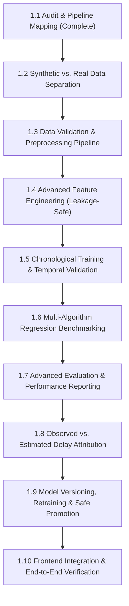

# MicroDelay 2.0 — Phase 1: Technical Audit & ML Pipeline Mapping

**Document Version:** 1.0.0  
**Date:** November 2026  
**Status:** Complete  
**Scope:** Architecture Audit, ML Pipeline Inspection, Risk Assessment, and Implementation Roadmap for MicroDelay Phase 1 (Data Integrity & ML Validation).

---

## 1. Executive Summary

MicroDelay is an intelligent behavioral time-estimation application designed to mitigate the "planning fallacy" and routine morning micro-delays (such as item searching, last-minute digital distractions, and estimation biases). The existing system features a personal Random Forest regressor per user, heuristic delay attribution across five categories, synthetic 60-day schedule generation across four user personas, and a React-based interactive simulator and dashboard.

This audit evaluates the reliability, scientific validity, data integrity, and architectural soundness of the existing implementation before initiating Phase 1 development.

### Key Audit Findings
1. **Zero Data Provenance:** Synthetic demonstration records (60 days generated on registration) and genuine simulator checkout observations are stored in the same database table (`departure_logs`) with no distinguishing flags. Consequently, models and behavioral insights report synthetic artifacts as authentic user habits.
2. **Data Leakage in Temporal Modeling:** The evaluation pipeline employs standard pseudo-random `train_test_split` (80/20) on time-series departure records, violating temporal causality by allowing future observations to predict past delays.
3. **Fragile Feature Representation:** Categorical event encoding relies on a hardcoded list of 22 strings in `models.py`. Any custom routine created by a user through the Routine Builder receives all-zero feature encodings.
4. **Synchronous Unprotected Model Retraining:** Model training is invoked synchronously on every checkout and on every `GET /api/metrics` call, directly overwriting unversioned `.pkl` files without candidate validation or rollback capabilities.
5. **Path Resolution Anomalies:** Relative directory specifications (`backend/models`) result in duplicated paths (`backend/backend/models/`) when processes are started inside the `backend` directory.
6. **Heuristic Delay Attribution:** Delays are allocated using fixed static ratio weights (6:5:3:4) across checked categories rather than distinguishing directly measured behavioral durations from inferred residuals.
7. **Zero Automated Test Coverage:** The repository currently contains zero test files, unit tests, or integration tests.

---

## 2. Current Architecture

### 2.1 Technology Stack

| Layer | Technologies | Current Version / Notes |
|---|---|---|
| **Backend** | Python, FastAPI, Starlette, Uvicorn, Pydantic | FastAPI 0.141+, Pydantic v2, Python 3.14 venv |
| **Database & ORM** | SQLite, SQLAlchemy | SQLite file `microdelay.db`, SQLAlchemy 2.0+ ORM |
| **Machine Learning** | scikit-learn, pandas, NumPy, joblib | RandomForestRegressor, Event Baseline, joblib serialization |
| **Authentication** | PyJWT, PBKDF2-HMAC-SHA256 | Bearer JWT token, per-user salt + hashed password |
| **Frontend** | React 19, TypeScript, Vite, Recharts, Lucide | Vite 8, React 19.2, SPA architecture |
| **Deployment** | Docker, Docker Compose | Multi-stage Dockerfile (Node builder + Python runtime) |

### 2.2 System Topology



---

## 3. Existing Data Schema & Relationships

### 3.1 Entity Relationship Diagram



### 3.2 Schema Observations & Gaps

1. **Missing Data Provenance:** Neither `DepartureLog` nor any ancillary table records whether a row was synthetically generated (`generator.py`) or genuinely recorded via user interaction (`main.py:create_checkout_log`).
2. **Missing Observation Timestamps:** The records store calendar date (`date: YYYY-MM-DD`) and clock times (`HH:MM:SS`), but lack explicit ISO-8601 UTC creation timestamps (`created_at`, `recorded_at`), preventing unambiguous chronological sorting across time zones or DST shifts.
3. **Denormalized Event Attributes:** `event_name` is duplicated in `DepartureLog`. If `event_id` is set, `models.py` queries `Event` for `importance`, defaulting to `"medium"` if unlinked.
4. **String-based Time Storage:** Storing clock times as plain strings without time zone context leads to complex string parsing (`datetime.datetime.strptime`) and fragile midnight rollover calculations.
5. **No Model Registry Table:** Model versions, validation metrics, training sample counts, and artifact references are not tracked in the database.

---

## 4. End-to-End Data Lifecycle Analysis



### Critical Flaws in the Lifecycle

1. **Silent Data Mixing:** After registration, the database contains ~60 synthetic records. When the user performs a simulator checkout, record #61 is inserted into the exact same table without provenance metadata.
2. **Polluted Retraining:** Step 16 reads both synthetic and real records into the same training DataFrame. The newly trained Random Forest is largely fitted on synthetic noise rather than real user habits.
3. **Unbounded Synchronous Latency:** Retraining on every checkout (Step 15) increases API latency as historical records accumulate and creates race conditions under concurrent requests.
4. **Destructive Registration Generator:** If `generate_user_logs` is re-run for an existing user, it issues `db.query(DepartureLog).filter(DepartureLog.user_id == user_id).delete()`, wiping any real observations.

---

## 5. Existing Machine Learning Workflow Audit

### 5.1 Model Specifications

- **Current Algorithm:** `RandomForestRegressor(n_estimators=50, max_depth=5, random_state=42)`
- **Target Variable ($y$):** `total_delay_min` (departure delay = actual departure minus planned departure in minutes).
- **Baseline Algorithm:** Historical mean delay grouped by `event_name` (`train_df.groupby("event_name")["total_delay_min"].mean()`), defaulting to `global_mean`.
- **Feature Set:**
  1. `importance_code`: Ordinal mapping (`{"low": 0, "medium": 1, "high": 2}`, default `1`).
  2. `day_{day}`: 7 binary indicators for days of the week.
  3. `event_{clean_evt}`: 22 binary indicators for hardcoded event names.
  4. `bag_prepared`: Binary flag (`1` or `0`).
  5. `estimated_prep_duration_min`: User's planned prep time.
  6. `estimated_travel_duration_min`: User's planned transit time.

### 5.2 Preprocessing & Feature Engineering Vulnerabilities

1. **Closed Vocabulary for Events:**
   ```python
   # models.py:64-66
   for event in EVENT_NAMES:
       clean_evt = event.lower().replace(" ", "_").replace("&", "and")
       df[f"event_{clean_evt}"] = (df["event_name"] == event).astype(int)
   ```
   Users can add custom events in the Routine Builder (e.g., "Gym Commute", "Music Rehearsal"). These custom events never match `EVENT_NAMES`, silently receiving 0 for all event indicators and losing event identity.
2. **Missing Advanced Behavioral Signals:**
   - No rolling historical prep error / prep bias.
   - No time-of-day features (morning vs. afternoon routines).
   - No tracking of behavioral distraction frequencies (phone usage rate, item search frequency).
   - No recent behavioral momentum / change detection.
3. **Lack of scikit-learn Pipeline Encapsulation:** Feature transformations are implemented as ad-hoc pandas manipulations rather than reusable, fit/transform pipeline objects (`Pipeline`, `ColumnTransformer`).

### 5.3 Validation & Splitting Deficiencies

1. **Random Train-Test Split:**
   ```python
   # models.py:98
   train_df, test_df = train_test_split(df, test_size=test_size, random_state=42)
   ```
   For temporal and sequential behavioral data, random splitting introduces severe look-ahead leakage. Past observations are evaluated using models trained on future behavior.
2. **No Three-Way Partitioning:** There is no separate validation set for model selection or hyperparameter tuning. The test set is evaluated, and then the model is refitted on 100% of the data (`final_rf.fit(X_all, y_all)`), overwriting the evaluated estimator without an untouched holdout check.
3. **Misleading Metrics on Tiny Datasets:** The minimum data threshold is only 8 records. Evaluating an 80/20 split on 8 records yields a test set of **1 or 2 observations**, rendering MAE and error reduction percentages statistically meaningless and volatile.

---

## 6. Delay Attribution & Insights Engine Audit

### 6.1 Attribution Logic (`/api/checkout`)

When a user departs late (`pos_delay > 0`), the delay is partitioned across active tags using static weights:
$$\text{weights} = \{\text{one\_last\_task}: 6.0, \text{finding\_items}: 5.0, \text{phone\_usage}: 3.0, \text{waiting}: 4.0\}$$
$$\text{allocated}_i = \frac{w_i}{\sum_{j \in \text{active}} w_j} \times \text{pos\_delay}$$
$$\text{allocated\_prep\_bias} = \max\left(0.0, \text{pos\_delay} - \sum \text{allocated}_i\right)$$

### 6.2 Attribution Deficiencies

1. **Pro-Rata Weight Distortion:** If a user spent 2 minutes replying to a text and 15 minutes waiting for an elevator, the heuristic will allocate more delay to the text if higher weight tags are present, distorting reality.
2. **Conflation of Measured vs. Estimated Delays:** The system does not record whether a duration was directly measured/logged (e.g. active timer distraction of 4.5 minutes) versus mathematically apportioned.
3. **Negative Delays Ignored:** Early departures (`total_delay_min < 0`) zero out all allocation fields, discarding valuable efficiency data.
4. **Insights Synthetic Contamination:** `/api/insights` computes personal prep bias and recommendations by aggregating all logs in the database. Since 60 rows are synthetic and only a few are real, the recommendation engine advises users based on simulated persona patterns rather than true personal bottlenecks.

---

## 7. Model Versioning & Persistence Audit

### 7.1 Pathing and Directory Confusion

In `backend/models.py`:
```python
def get_model_paths(user_id: int):
    os.makedirs("backend/models", exist_ok=True)
    return {
        "model": f"backend/models/rf_model_user_{user_id}.pkl",
        "features": f"backend/models/feats_user_{user_id}.pkl",
        "baseline": f"backend/models/baseline_user_{user_id}.pkl"
    }
```
- If the app is launched from `E:\DATA PROJ\`, artifacts go to `E:\DATA PROJ\backend\models\`.
- If the app is launched from `E:\DATA PROJ\backend` (standard for `uvicorn main:app`), artifacts go to `E:\DATA PROJ\backend\backend\models\`.
- The repository already contains both folders, indicating past path resolution bugs.

### 7.2 Safety & Concurrency Vulnerabilities

1. **No Atomicity / Rollback:** Files are overwritten directly with `joblib.dump`. If process execution is interrupted during a dump, the user's model is permanently corrupted.
2. **No Promotion Guardrails:** A newly trained model immediately replaces the existing model regardless of whether its validation MAE is worse than the current model or worse than the baseline.
3. **Pickle Security:** Model artifacts are plain pickles loaded directly via `joblib.load`. Without integrity verification or metadata validation, arbitrary file tampering could lead to unsafe code execution.

---

## 8. Test Coverage Assessment

### Current Test Inventory
- **Total Test Files Found:** `0`
- **Unit Test Coverage:** `0%`
- **Integration Test Coverage:** `0%`
- **Regression Test Coverage:** `0%`

### Missing Automated Test Suites
1. **Data Provenance Tests:** Verifying synthetic tags on generation, real tags on checkout, and dataset isolation during training.
2. **Data Preprocessing & Validation Tests:** Verifying rejection of negative durations, invalid timestamps, unknown categories, and extreme outlier handling.
3. **Feature Engineering Tests:** Verifying calculation accuracy, absence of look-ahead leakage, and temporal rolling consistency.
4. **Chronological Splitting Tests:** Proving training sets strictly precede validation and test sets in time.
5. **Model Benchmarking Tests:** Validating multi-model training (Baseline, Linear, Random Forest, HistGradientBoosting) and metric generation.
6. **Model Promotion & Rollback Tests:** Testing candidate comparison, promotion rules, and fallback mechanisms.
7. **Delay Attribution Tests:** Testing zero delay, negative delay, observed vs. estimated separation.
8. **End-to-End API Tests:** Testing registration, login, checkout, prediction, and dashboard metrics with authenticated sessions.

---

## 9. Comprehensive Problem Matrix & Proposed Phase 1 Solutions

| ID | Domain | Identified Problem | Root Cause | Proposed Solution | Target Prompt |
|---|---|---|---|---|---|
| **P-01** | Data Integrity | Synthetic and genuine observations are mixed indiscriminately | No provenance attribute on `DepartureLog` | Add `data_source` / `is_synthetic` / `provenance` enum to `DepartureLog`; update generator & checkout; support partitioned training datasets | Prompt 1.2 |
| **P-02** | Data Integrity | Database wipes real observations if re-seeded | `generate_user_logs` calls unconditional delete | Scope generator cleanup to synthetic records only; never delete real user records | Prompt 1.2 |
| **P-03** | Validation | Unvalidated input records (negative durations, extreme values, format errors) | Direct mapping from schema to DB without preprocessing validation | Centralized `backend/ml/preprocessing.py` with schema validation, configurable sanity checks, and clean error logging | Prompt 1.3 |
| **P-04** | ML Pipeline | Unknown custom event names lose categorical identity | Hardcoded 22-item event list in `models.py` | Scikit-learn `OneHotEncoder(handle_unknown='ignore')` or frequency/target encoding within a fitted `ColumnTransformer` | Prompt 1.3 |
| **P-05** | ML Pipeline | Information leakage via random train-test splitting | `train_test_split(..., random_state=42)` on temporal logs | Implement chronological split (70% train / 15% val / 15% test) and expanding-window temporal cross-validation | Prompt 1.5 |
| **P-06** | Feature Engineering | Limited behavioral signals & risk of look-ahead leakage | Only 6 static features; no historical aggregates | Develop temporal rolling features (historical prep bias, past distraction frequencies) with strict cutoff prior to departure time | Prompt 1.4 |
| **P-07** | ML Pipeline | Single unbenchmarked algorithm (Random Forest) | Hardcoded `RandomForestRegressor` without algorithm comparison | Multi-model benchmarking suite (Baseline, Linear Regression, Random Forest, HistGradientBoosting, XGBoost) with MAE/RMSE/Tolerance metrics | Prompt 1.6 |
| **P-08** | Evaluation | Fragile and uninformative metrics on small sample sizes | Evaluating 1-2 test samples; single metric reported | Standardize evaluation metrics (MAE, RMSE, $R^2$, median error, $\pm 5$m tolerance), error segmentation, residual analysis, and machine-readable JSON/Markdown reports | Prompt 1.7 |
| **P-09** | Attribution | Delay attribution uses artificial static pro-rata weights | Heuristic formulas in checkout endpoint conflate observed & estimated delays | Decompose attribution into directly observed durations vs. model-estimated contributions; store attribution type and confidence | Prompt 1.8 |
| **P-10** | MLOps | Unversioned model overwrites; relative path bugs (`backend/backend/models`) | Hardcoded relative strings in `get_model_paths`; no metadata database table | Model metadata table (`model_versions`); versioned storage; absolute base path resolution; safe promotion and rollback | Prompt 1.9 |
| **P-11** | Frontend | User cannot see whether metrics come from synthetic demo data or real history | UI displays one aggregate stats view without provenance indicators | Data quality badge, model status cards, model comparison Recharts, observed vs. estimated breakdown, and onboarding empty states | Prompt 1.10 |
| **P-12** | Quality / DevOps | Zero automated test coverage; UTF-16LE encoding on `requirements.txt` | Missing test suite; Windows PowerShell encoding artifact | Add full `pytest` test suite covering all modules; clean `requirements.txt` to standard UTF-8 with `pytest`, `httpx` dependencies | Prompts 1.2 – 1.10 |

---

## 10. Affected Files & Architectural Modifications

### Existing Files Requiring Modification

| File | Proposed Modifications |
|---|---|
| `backend/database.py` | Add provenance columns to `DepartureLog` (`data_source`, `is_synthetic`, `recorded_at`); create `ModelVersion` metadata table; provide safe backward-compatible SQLite migration logic. |
| `backend/generator.py` | Mark all generated records as `synthetic`; ensure generator does not delete real user observations; attach explicit timestamps. |
| `backend/main.py` | Update `/api/checkout` to log `real` provenance and structured attribution; update `/api/metrics` and `/api/insights` to respect provenance; decouple heavy synchronous retraining from request paths. |
| `backend/models.py` | Refactor into modular ML package; deprecate unversioned file overwrites; integrate with versioned model registry. |
| `backend/requirements.txt` | Fix UTF-16 encoding to UTF-8; pin dependencies; add `pytest`, `httpx`, and optional gradient boosting libraries. |
| `frontend/src/App.tsx` | Add data provenance indicator, model status card, model benchmark comparison, distinct observed vs. estimated delay displays, and empty states for users with insufficient real data. |

### New Files to Create

| File | Purpose |
|---|---|
| `backend/ml/__init__.py` | ML module initialization. |
| `backend/ml/preprocessing.py` | Centralized data validation, cleaning, and scikit-learn preprocessing pipelines. |
| `backend/ml/features.py` | Advanced leakage-safe behavioral feature engineering with temporal ordering. |
| `backend/ml/validation.py` | Chronological splitting (70/15/15) and expanding-window cross-validation. |
| `backend/ml/benchmark.py` | Multi-algorithm benchmarking pipeline (Baseline, OLS, RF, HistGradientBoosting, XGBoost). |
| `backend/ml/evaluation.py` | Comprehensive metric evaluation, error segmentation, residual analysis, and report generation. |
| `backend/ml/attribution.py` | Observed vs. estimated delay attribution engine. |
| `backend/ml/registry.py` | Versioned model artifact storage, promotion, rollback, and retrieval. |
| `backend/tests/` | Comprehensive test suite for all backend and ML modules. |
| `backend/reports/` | Output directory for structured JSON and Markdown evaluation reports. |

---

## 11. Backward Compatibility & Migration Strategy

1. **Database Schema Evolution:**
   - Existing SQLite database contains 219 historical records across 4 demo users.
   - Migrations will use `ALTER TABLE` or SQLAlchemy table reflection with fallback defaults.
   - Existing records will be classified as `synthetic` based on their known initial demo generation source. Unknown historical records will be marked `unknown` rather than fabricating real provenance.
2. **API Contract Compatibility:**
   - Existing endpoints (`/api/predict`, `/api/logs`, `/api/metrics`, `/api/insights`) must preserve their existing JSON response fields so existing frontend components remain functional while new Phase 1 fields are added.
3. **Artifact Compatibility:**
   - Legacy model pickle files (`backend/models/rf_model_user_{id}.pkl`) will remain accessible as fallbacks until the versioned model registry is populated and verified.

---

## 12. Recommended Phase 1 Implementation Order



---

## 13. Audit Sign-Off & Verification

- **Code Inspection Completed:** `backend/database.py`, `backend/generator.py`, `backend/main.py`, `backend/models.py`, `backend/security.py`, `backend/seed_demo_users.py`, `frontend/src/App.tsx`, `frontend/src/index.css`.
- **Database Inspection Completed:** `backend/microdelay.db` inspected (4 users, 26 events, 219 logs).
- **Environment Inspected:** Python 3.14.6 in `.\venv`, Node dependencies in `frontend/package.json`.
- **Pre-existing Code Modifications in this Step:** None (Audit and planning checkpoint strictly preserved).
