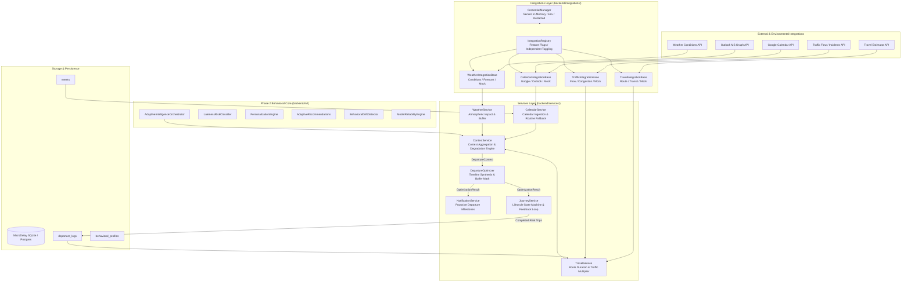
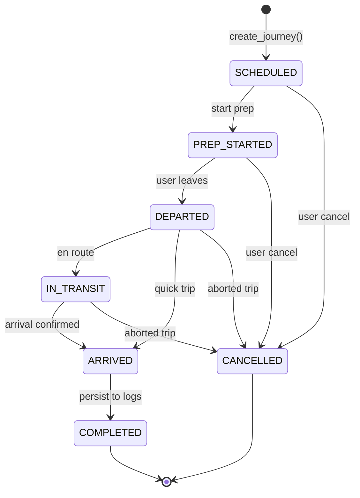

# MicroDelay 2.0 — Phase 3 Architecture
## Context-Aware Departure Intelligence Architecture

---

## 1. Architectural Overview

MicroDelay Phase 3 establishes a **Context-Aware Departure Intelligence Architecture**. It bridges personalized behavioral intelligence (developed in Phase 1 and Phase 2) with external environmental, scheduling, routing, traffic, and atmospheric conditions.

The objective is to transform static routine planning into a dynamic, situation-aware departure engine capable of:
1. Ingesting upcoming calendar schedules (Google Calendar, Microsoft Outlook, and database routine templates).
2. Estimating dynamic route travel durations and distance.
3. Incorporating real-time traffic congestion conditions and incident delays.
4. Factoring weather severity and precipitation probabilities into departure buffers.
5. Synthesizing Phase 2 behavioral delay predictions with live external factors into a unified `DepartureContext`.
6. Dynamically optimizing departure timelines (prep start, departure, safety buffer, arrival).
7. Scheduling proactive notifications across distinct departure milestones.
8. Tracking live journey lifecycles from preparation to arrival, closing the continuous learning loop into model retraining.



---

## 2. Phase 1 & 2 Architectural Audit

A comprehensive audit of the existing codebase identified key components that interface with the Phase 3 architecture:

| Component | Location | Role in Phase 3 Integration |
| :--- | :--- | :--- |
| **Prediction Services** | `backend/models.py`, `backend/ml/classifier.py`, `backend/ml/global_model.py` | Supplies baseline regression, lateness risk classification, and cold-start fallback models. |
| **Behavioral Orchestration** | `backend/ml/adaptive/orchestrator.py` | Central `AdaptiveIntelligenceOrchestrator` invoked by `ContextService` to supply personalized prep duration and behavioral risk factors. |
| **Prediction Context** | `backend/ml/adaptive/context.py` | Phase 2 context object (`PredictionContext`) for pure ML inference; populated by `ContextService` without future lookahead. |
| **User Preferences & Consent** | `backend/database.py` (`User` model) | User profile types (`student`, `teacher`, `professor`, `it_professional`), global training consent, and constraint boundaries. |
| **Routine Templates & Events** | `backend/database.py` (`Event` model) | User routine templates with `start_time`, `estimated_prep_duration`, `estimated_travel_duration`, and `importance`; acts as the primary calendar fallback. |
| **Historical Travel Features** | `backend/database.py` (`DepartureLog`) | Historical genuine logs (`actual_travel_duration_min`, `actual_prep_duration_min`) queried by `TravelService` as traffic/travel fallbacks. |
| **API Authentication** | `backend/security.py`, `backend/main.py` | JWT Bearer authentication scheme protecting all context, optimization, and journey endpoints. |

---

## 3. Modular Integration Architecture

The integration layer (`backend/integrations/`) is decoupled from business logic and database models:

```
backend/integrations/
├── __init__.py               # Public exports
├── base.py                   # Data contracts, ObservationMetadata, BaseIntegration
├── credentials.py            # Secure CredentialManager & OAuthToken
├── registry.py               # IntegrationRegistry & feature toggling
├── calendar/
│   ├── __init__.py
│   ├── base.py               # CalendarIntegrationBase, CalendarEvent
│   ├── google.py             # GoogleCalendarIntegration (OAuth2)
│   ├── outlook.py            # OutlookCalendarIntegration (MS Graph)
│   └── mock.py               # MockCalendarIntegration (Deterministic testing)
├── travel/
│   ├── __init__.py
│   ├── base.py               # TravelIntegrationBase, TravelEstimate, TravelMode
│   └── mock.py               # MockTravelIntegration (Distance / Duration)
├── traffic/
│   ├── __init__.py
│   ├── base.py               # TrafficIntegrationBase, TrafficObservation, CongestionLevel
│   └── mock.py               # MockTrafficIntegration (Flow & Incidents)
└── weather/
    ├── __init__.py
    ├── base.py               # WeatherIntegrationBase, WeatherObservation, Severity
    └── mock.py               # MockWeatherIntegration (Atmospheric impact)
```

Each integration provider derives from `BaseIntegration` which enforces:
- Explicit service and provider naming (`calendar:google_calendar`, `traffic:tomtom`, etc.).
- Independent enable/disable state flags.
- Standardized health check reporting (`IntegrationHealth`).
- Standardized metadata generation for all external observations.

---

## 4. Consistent External Data Contract

Every external observation records a strict metadata contract (`ExternalObservationMetadata`) ensuring full data provenance and temporal traceability:

```python
@dataclass
class ExternalObservationMetadata:
    source: str                    # Provider ID, e.g. "traffic:tomtom_flow"
    retrieval_timestamp: str       # ISO 8601 UTC timestamp of retrieval
    applicable_id: Optional[str]   # Event ID or Journey ID
    valid_from: Optional[str]      # Validity window start (ISO 8601 UTC)
    valid_until: Optional[str]     # Validity expiration timestamp (ISO 8601 UTC)
    observation_type: ObservationType # "live", "forecast", "historical", "estimated"
    confidence: float              # 0.0 to 1.0 confidence score
    is_fallback: bool              # True if graceful fallback was engaged
    latency_ms: float              # API latency in milliseconds
    details: Dict[str, Any]        # Provider-specific audit payload
```

### Observation Types
- **`live`**: Real-time probe directly from active external sensors or APIs (e.g., live traffic speed, real-time calendar pull).
- **`forecast`**: Forward-looking projection (e.g., hourly weather precipitation forecast, predictive travel-time model).
- **`historical`**: Derived from genuine past user departure records in `departure_logs` (e.g., rolling mean travel time).
- **`estimated`**: Heuristic or static configured estimate (e.g., routine template travel duration, fallback buffers).

---

## 5. Unified Departure Context (`DepartureContext`)

The `DepartureContext` is the central domain object encapsulating all situational information at the moment of optimization:

```python
@dataclass
class DepartureContext:
    user_id: int
    event_id: Optional[str]
    event_name: str
    event_start_time: str              # ISO 8601 UTC
    event_location: Optional[str]
    current_location: Optional[str]
    destination: Optional[str]
    event_importance: str              # "low", "medium", "high", "critical"
    estimated_prep_duration: float     # User/routine baseline prep (min)
    personalized_prep_duration: float  # Phase 2 ML-personalized prep (min)
    estimated_travel_duration: float   # Baseline route travel time (min)
    live_travel_duration: Optional[float] # Traffic-adjusted live travel time (min)
    weather_conditions: Optional[Dict[str, Any]]
    traffic_conditions: Optional[Dict[str, Any]]
    safety_buffer: float               # Dynamic multi-factor safety buffer (min)
    context_timestamp: str             # Timestamp of snapshot assembly
    source_metadata: Dict[str, Dict[str, Any]] # Provenance per source
    degradation_status: Dict[str, str] # Health/degradation status per domain
    is_destination_required: bool      # Flagged when destination is missing
    missing_fields: List[str]          # Missing fields required for full live precision
    behavioral_risk_category: Optional[str]
    predicted_delay_min: Optional[float]
    ttl_seconds: int = 300
```

### Context Validation & Lifecycle
- `is_expired(at_time)`: Checks if `(current_time - context_timestamp) > ttl_seconds`.
- `validate()`: Verifies positive IDs, physical duration sanity bounds `[0, 360m]` for prep, `[0, 720m]` for travel, and flags missing destinations.

---

## 6. Graceful Degradation Matrix

The architecture provides fault isolation across all integrations. External outages never crash the service:

| Integration / Domain | Failure Mode | Degradation Strategy | `degradation_status` Value |
| :--- | :--- | :--- | :--- |
| **Calendar** | OAuth token expired, API timeout, or unconfigured | Look up routine template from database `Event` table; if none found, synthesize sensible default. | `"database_routine_template"` or `"heuristic_default"` |
| **Travel** | Route calculation error, network timeout, invalid negative values | Compute user's historical mean travel duration from genuine `departure_logs` for this event or user. | `"historical_personal_travel"` or `"travel_api_unavailable"` |
| **Traffic** | Traffic flow sensor outage or API error | Apply travel baseline with 1.0 multiplier and 0 congestion delay; log omission in metadata. | `"traffic_unavailable_fallback"` |
| **Weather** | Weather provider unavailable or rate-limited | Omit atmospheric adjustments (extra weather buffer = 0.0 min); proceed without penalty. | `"weather_disabled"` or `"weather_failed_fallback"` |
| **Destination** | Event or routine has no destination address | Retain routine travel estimate, flag `is_destination_required = True`, request user input. | `"destination_missing"` |
| **Behavioral ML** | User has fewer than 8 real observations | Fall back to pre-trained global regression model and population heuristics. | `"baseline_fallback"` |

---

## 7. Secure Credential Management

Security and credential integrity are enforced through `CredentialManager`:
1. **Zero Hardcoded Secrets**: No API keys, client secrets, or OAuth tokens exist in source code or repository files.
2. **Environment Variable Fallback**: Follows hierarchical naming:
   - `MICRODELAY_{SERVICE}_{KEY}` $\rightarrow$ `{SERVICE}_{KEY}` $\rightarrow$ `{KEY}`.
3. **Automated Secret Masking**: Keys inspected via logging or diagnostics are masked:
   - Long keys: `AIzaSyDummySecretKey12345` $\rightarrow$ `AIza...2345`.
   - Short keys: `secret` $\rightarrow$ `***`.
4. **OAuth Token Lifecycle**: `OAuthToken` tracks `expires_at` with configurable safety buffers (default 60 seconds), preventing in-flight token rejections.
5. **No Secret Leakage in APIs**: REST endpoints expose only health and operational status, never authorization headers or decrypted secrets.

---

## 8. Dynamic Departure Optimization Math

The `DepartureOptimizer` translates the unified context into an actionable departure timeline:

$$\text{Target Arrival Time} = \text{Event Start Time} - \text{Early Padding}$$

$$\text{Effective Travel} = \begin{cases} \text{live\_travel\_duration} & \text{if live traffic available} \\ \text{estimated\_travel\_duration} & \text{otherwise} \end{cases}$$

$$\text{Safety Buffer} = \max\left(\text{Min Buffer}, \min\left(\text{Importance Buffer} \times \text{Risk Multiplier} + \text{Weather Buffer}, \text{Max Buffer}\right)\right)$$

$$\text{Recommended Departure Time} = \text{Target Arrival Time} - \text{Effective Travel} - \text{Safety Buffer}$$

$$\text{Recommended Prep Start Time} = \text{Recommended Departure Time} - \text{Personalized Prep Duration}$$

### Timeline Segments Produced
1. **`preparation`**: From `recommended_prep_start_time` to `recommended_departure_time`.
2. **`safety_buffer`**: From `recommended_departure_time` for the duration of the safety buffer.
3. **`transit`**: Active route traversal to destination.
4. **`arrival`**: Arrival padding settling in prior to event start.

---

## 9. Smart Notifications & Journey Lifecycle

### Smart Notification Milestones
`NotificationService` calculates proactive, scheduled alerts relative to the computed timeline:
- **`prep_heads_up`**: 15 minutes prior to prep start.
- **`prep_start`**: Exactly at `recommended_prep_start_time`.
- **`departure_countdown`**: 5 minutes before `recommended_departure_time`.
- **`depart_now`**: Exactly at `recommended_departure_time`.
- **`en_route_delay`**: Triggered if live traffic conditions deteriorate during transit.

### Journey Tracking State Machine
`JourneyService` governs active user journeys through validated transitions:



When a journey reaches `COMPLETED`, `JourneyService` records the actual timestamps into `departure_logs` with provenance `DataProvenance.REAL`, closing the active feedback loop into Phase 1 & 2 model retraining and drift monitoring.

---

## 10. API Specification

| Method | Endpoint | Description |
| :--- | :--- | :--- |
| `GET` | `/api/integrations/status` | Inquire operational and health status across all registered integration adapters. |
| `POST` | `/api/integrations/toggle` | Enable or disable an integration provider or entire category independently. |
| `POST` | `/api/context/departure` | Aggregate situational context into a unified `DepartureContext` object. |
| `GET` | `/api/context/departure` | Retrieve current departure context via query parameters. |
| `POST` | `/api/departure/optimize` | Generate optimal departure times and segmented timeline from context. |
| `POST` | `/api/notifications/departure` | Schedule proactive departure notifications for an upcoming event. |
| `GET` | `/api/notifications/departure` | Retrieve pending notifications that are currently due. |
| `POST` | `/api/journey/start` | Initialize active journey tracking for a departure context. |
| `POST` | `/api/journey/{journey_id}/transition` | Advance journey through state machine (`prep_started`, `departed`, `arrived`, etc.). |
| `GET` | `/api/journey/{journey_id}` | Inquire active status and timestamps of an in-flight journey. |

---

## 11. Test Coverage & Verification

Automated test suite (`backend/tests/test_context_aware_intelligence.py`) covers:
1. **Data Contract Compliance**: Verified retrieval timestamps, valid_until bounds, and observation types.
2. **Credential Redaction**: Verified secret masking, environment fallback, and OAuth expiry checks.
3. **Independent Service Boundaries**: Verified registry lifecycle and per-provider enable/disable isolation.
4. **Graceful Degradation**: Tested scenarios where external calendar, travel, traffic, and weather are disabled or unavailable.
5. **Partial Context Aggregation**: Tested combinations where some providers succeed and others fail.
6. **Data Validation & Error Recovery**: Tested resilience to negative travel times, unparseable dates, and API timeouts.
7. **Authentication Failures**: Verified OAuth token expiration handling without application crash.
8. **Missing Destination Detection**: Verified detection, warning generation, and user-prompt flags.
9. **Context Expiration**: Verified TTL validation.
10. **Departure Optimization**: Verified timeline math, early arrival padding, and multi-factor safety buffers.
11. **Smart Notification Scheduling**: Verified milestone scheduling and dispatch state tracking.
12. **Journey Tracking**: Verified state machine transitions, illegal transition rejection, and DB persistence.
13. **Backward Compatibility**: Verified that all Phase 1 regression and Phase 2 adaptive intelligence endpoints continue to operate identically.

**Test Results Summary**:
- Phase 3 Context-Aware Intelligence tests: **20/20 PASSED**.
- Google Calendar Integration tests: **15/15 PASSED**.
- Microsoft Outlook Calendar Integration tests: **12/12 PASSED**.
- Full test suite (Phase 1, Phase 2, and Phase 3): **199/199 PASSED**.

---

## 12. Google Calendar Integration (Prompt 3.2)

### 12.1 Overview & Goals
MicroDelay 2.0 Prompt 3.2 integrates **Google Calendar** via official Google OAuth 2.0 and the Google Calendar API v3 (`google-api-python-client`, `google-auth`, `google-auth-oauthlib`). This removes the requirement for users to manually configure every departure routine.

Key capabilities:
1. **OAuth 2.0 with PKCE & Anti-CSRF State**:
   - RFC 7636 Proof Key for Code Exchange (`code_challenge` / `code_verifier` with `S256`).
   - Ephemeral in-memory state store with 10-minute TTL and single-use validation preventing CSRF attacks.
   - Strict redirect URI validation.
   - Minimal scope enforcement: read-only access (`https://www.googleapis.com/auth/calendar.readonly`).
2. **Encrypted Token Management**:
   - AES-128-CBC + HMAC-SHA256 authenticated encryption via `Fernet` derived using PBKDF2 from `SECRET_KEY`.
   - Never exposes access or refresh tokens to React frontend or plaintext logs.
   - Automatic token refresh on expiration using `google.auth.transport.requests.Request`.
   - Complete token revocation on disconnection via `https://oauth2.googleapis.com/revoke`.
3. **Idempotent Synchronization Engine**:
   - Initial synchronization + incremental synchronization utilizing provider `syncToken`.
   - Graceful recovery from HTTP 410 Gone (expired sync token) triggering a clean resync without data duplication.
   - Expands recurring events using `singleEvents=True`, tracking `recurring_event_id` and unique instance timestamps.
   - Timezone conversion preserving event start/end in ISO 8601 UTC.
4. **Intelligent Event Filtering & Classification**:
   - `EventFilterService` parses event summaries, locations, and conferencing links.
   - Automatically detects virtual meetings: Zoom (`zoom.us`), Google Meet (`meet.google.com`), Microsoft Teams (`teams.microsoft.com`), Cisco Webex (`webex.com`).
   - Identifies all-day events, cancelled events, and physical locations.
   - Surfaces `has_missing_location` warnings for physical events missing actionable destination addresses.
   - Enables user classification overrides: `physical`, `online`, `personal`, or `excluded`.
5. **Departure Planning & Routine Association**:
   - Bridges calendar events into `DepartureOptimizer` to compute prep start times, target departures, travel duration, and multi-factor safety buffers.
   - Supports linking calendar events to existing routine templates to inherit personalized preparation buffers and travel modes.
6. **Frontend Controls**:
   - `CalendarConnectionsSection` React component in `frontend/src/components/CalendarConnectionsSection.tsx`.
   - Account connection card with last synced timestamp, manual sync trigger, and disconnect option.
   - Event filter pills (`All`, `Requires Departure`, `Physical`, `Online`, `Personal`, `Missing Location`).
   - Inline location warning alerts and classification override selectors.
   - Interactive departure plan modal displaying the full departure timeline breakdown.

### 12.2 Database Schema
- **`calendar_connections`**: Stores `user_id`, `provider` (`google` or `outlook`), `provider_account_reference` (email/account ID), `encrypted_tokens`, `connection_status`, `connected_at`, `last_synced_at`, `sync_token`, and `granted_scopes`.
- **`calendar_event_records`**: Stores `connection_id`, `user_id`, `provider_event_id`, `title`, `start_time`, `end_time`, `is_all_day`, `location`, `has_missing_location`, `online_meeting_url`, `status`, `travel_requirement`, `requires_departure_planning`, `missing_location_warning`, `recurrence_rule`, `recurring_event_id`, and `associated_routine_id`.

---

## 13. Microsoft Outlook Calendar Integration (Prompt 3.3)

### 13.1 Overview & Architecture
Prompt 3.3 expands MicroDelay's context-aware intelligence with native **Microsoft Outlook & Microsoft 365** calendar support. The integration conforms to the unified calendar architecture, ensuring that Google and Outlook events share the exact same normalized representation, event classification heuristics, and departure planning algorithms.

Key architectural capabilities:
1. **Microsoft Identity Platform OAuth 2.0 with PKCE & Anti-CSRF**:
   - Implements authorization code grant with RFC 7636 PKCE (`code_challenge` / `code_verifier` with `S256`).
   - Anti-CSRF single-use state verification with 10-minute TTL via `OAuthStateStore`.
   - Delegated minimum read-only permissions: `Calendars.Read`, `User.Read`, `offline_access`.
   - Automatic token refresh on expiry against `https://login.microsoftonline.com/{tenant}/oauth2/v2.0/token`.
   - All OAuth tokens encrypted at rest via AES-128-CBC + HMAC-SHA256 authenticated encryption (`OAuthTokenCrypto`).
2. **Microsoft Graph API Delta Synchronization**:
   - Queries `https://graph.microsoft.com/v1.0/me/calendarView/delta` within a sliding date window (-3 days to +30 days).
   - Automatically expands recurring event series into distinct instances (`seriesMasterId` retained for traceability).
   - Multi-page pagination via `@odata.nextLink`.
   - Delta token tracking via `@odata.deltaLink` stored in `connection.sync_token`.
   - Handles deleted calendar entries using Microsoft Graph's `@removed: {"reason": "deleted"}` indicators.
   - Graceful recovery from expired delta tokens (HTTP 410 Gone / `resyncRequired`), triggering an automatic clean full resynchronization.
3. **Event Filtering & Intelligent Classification**:
   - `EventFilterService` detects online meetings (Teams join URLs, `isOnlineMeeting: true`, Skype).
   - Distinguishes physical departures from personal blocks, focus times, and all-day events.
   - Detects missing destinations for physical meetings and flags `missing_location_warning`.
   - Allows user classification overrides (`physical`, `online`, `personal`, `excluded`).
4. **Unified Calendar Abstraction & Duplicate Prevention**:
   - Both Google Calendar and Microsoft Outlook normalize external events into the common `CalendarEventRecord` schema.
   - Event identity is strictly bounded by `(connection_id, provider_event_id)` backed by unique database index `idx_calendar_events_conn_provider_id`.
   - Multi-calendar coexistence: a user can connect both Google and Outlook simultaneously; identical event titles across different providers are never merged.
   - Repeated syncs update existing records idempotently without inserting duplicates.
   - Independent disconnect: disconnecting Outlook clears only Outlook events and tokens, leaving Google Calendar connections intact.
5. **Unified Frontend Interface**:
   - `CalendarConnectionsSection` provides dual cards for Google and Microsoft Outlook.
   - Real-time connection statuses, account references, last synced timestamps, and independent sync/disconnect actions.
   - Unified upcoming schedule with provider pills (`Google` / `Outlook`), missing location alerts, routine association selectors, and one-click departure optimization.

---

## 14. Travel & Route Intelligence Engine (Prompt 3.4)

### 14.1 Overview & Architecture
Prompt 3.4 establishes MicroDelay's context-aware **Travel & Route Intelligence Engine**, transitioning departure planning from static user estimates to dynamic, multi-modal, traffic-aware, and behaviorally personalized travel calculations.

Key architectural capabilities:
1. **Location Management System**:
   - User-saved frequent locations (`Home`, `College / Workplace`, `Frequent`, `Custom`) stored in `user_saved_locations`.
   - Explicit user authorization only: **no continuous background GPS tracking**.
   - Support for designating a primary location (e.g. Home) used as the automatic origin anchor during departure planning.
   - Strict user data isolation preventing cross-account data leaks.
2. **Geocoding & Persistent Caching**:
   - Address validation (`validate_address`) and geographic coordinate boundary validation (`validate_coordinates` for latitude $[-90, 90]$ and longitude $[-180, 180]$).
   - `GeocodingManager` orchestrates lookup with multi-tier caching: in-memory fast cache and persistent database cache (`geocode_cache` table) with SHA-256 query hashing and configurable TTL (default 30 days).
   - Provider abstraction supporting OpenStreetMap Nominatim, Google Maps Geocoding API, and deterministic mock geocoding fallback for offline and testing environments.
   - Reverse geocoding support translating coordinates to formatted addresses.
3. **Route Provider Abstraction & Multi-Modal Routing**:
   - `TravelIntegrationBase` defines standardized data contracts (`RouteOption`, `TravelEstimate`) returning origin, destination, travel mode, base duration, traffic-aware duration, distance in km, route identifier/summary, retrieval timestamp, provider name, and warnings.
   - Multi-modal support across 4 transport modes:
     - `driving` (traffic-aware duration via live conditions)
     - `transit` (public transit travel times)
     - `bicycling` (cycling routes and speed calibration)
     - `walking` (pedestrian routes and realistic walking pace)
   - Google Maps Routes & Directions API adapter (`GoogleRoutesIntegration`) supporting multiple route alternatives, traffic-in-duration, and overview polyline extraction.
   - Deterministic `MockTravelIntegration` with multi-route generation, custom route duration overrides, and mode duration scaling.
4. **Route Selection, Comparison & User Preferences**:
   - Side-by-side mode comparison (`compare_modes` endpoint) comparing driving, transit, bicycling, and walking in a single call.
   - User-saved preferred corridors (`user_saved_routes`) storing preferred routes, distance, and historical notes separately from journey observation logs.
   - Travel preferences (`user_travel_preferences`) storing default travel mode, toll avoidance, highway avoidance, and departure buffer multipliers.
5. **Historical Travel Data Preservation**:
   - For every completed departure, MicroDelay records `estimated_travel_duration_min`, `actual_travel_duration_min`, `selected_route`, `travel_mode`, `travel_estimate_retrieved_at`, and `data_source` in `departure_logs`.
   - **Strict immutability invariant**: The original provider or planned travel estimate is **NEVER overwritten** by actual travel duration, ensuring unbiased historical machine learning evaluation.
6. **Personalized Travel Estimation (Phase 2 ML Integration)**:
   - `PersonalizedTravelEngine` bridges Phase 2 behavioral intelligence with external routing estimates.
   - Calculates personal travel bias ratio:
     $$\Delta_{\text{bias}} = \frac{\sum D_{\text{actual}}}{\sum D_{\text{estimated}}}$$
   - Evaluates day-specific commuting factors (e.g. Monday morning congestion) and time-of-day rush-hour peak windows ($07:30 - 09:30$ and $16:30 - 18:30$).
   - Applies empirical Bayesian shrinkage: for sparse user journey observations ($N < 5$), estimates remain anchored tightly to provider routing; as observations accumulate, personalized behavioral weights smoothly scale up while bounded within sane multiplier clamps ($[0.65, 1.85]$).
7. **Frontend Travel Intelligence Section**:
   - `TravelIntelligenceSection` component featuring:
     - Reliability & bias analytics summary banner (total journeys, on-time percentage, mean bias minutes, bias ratio, behavioral insights).
     - Saved locations management cards (Home, Work, Custom) with primary toggle and geocoded coordinates.
     - Interactive route explorer with origin/destination inputs, mode selector, and alternative cards.
     - Side-by-side multi-modal comparison matrix.
     - Preferred route corridors list.
     - User travel preferences and buffer multiplier slider.

### 14.2 Database Schema Additions
- **`user_saved_locations`**: `id`, `user_id`, `name`, `category`, `address`, `latitude`, `longitude`, `is_primary`, `created_at`, `updated_at`.
- **`user_saved_routes`**: `id`, `user_id`, `name`, `origin_address`, `origin_lat`, `origin_lng`, `destination_address`, `destination_lat`, `destination_lng`, `travel_mode`, `preferred_route_identifier`, `distance_km`, `estimated_duration_min`, `notes`, `created_at`, `updated_at`.
- **`user_travel_preferences`**: `id`, `user_id` (unique), `default_mode`, `avoid_tolls`, `avoid_highways`, `buffer_multiplier`, `updated_at`.
- **`geocode_cache`**: `id`, `query_hash` (unique), `query_text`, `formatted_address`, `latitude`, `longitude`, `provider`, `cached_at`, `expires_at`.
- **`departure_logs`** (extended): `selected_route`, `travel_mode`, `travel_estimate_retrieved_at`.

